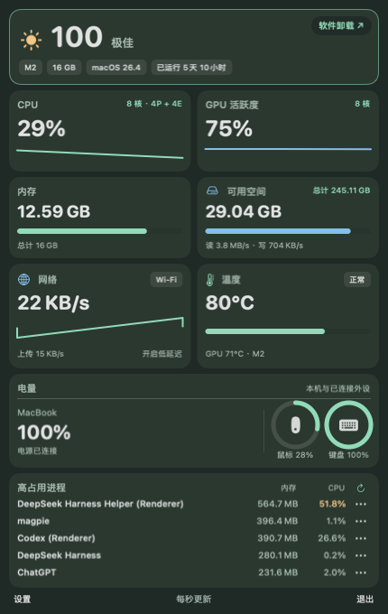
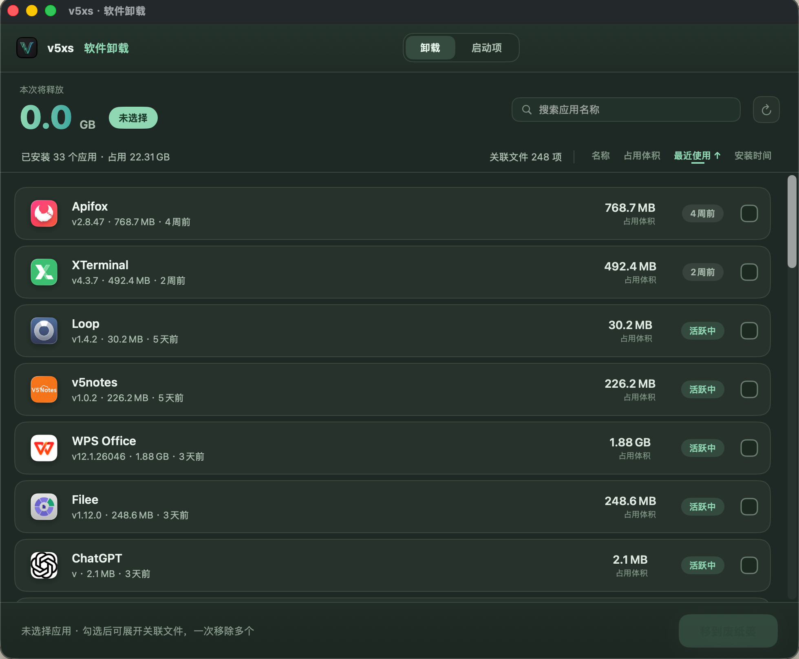
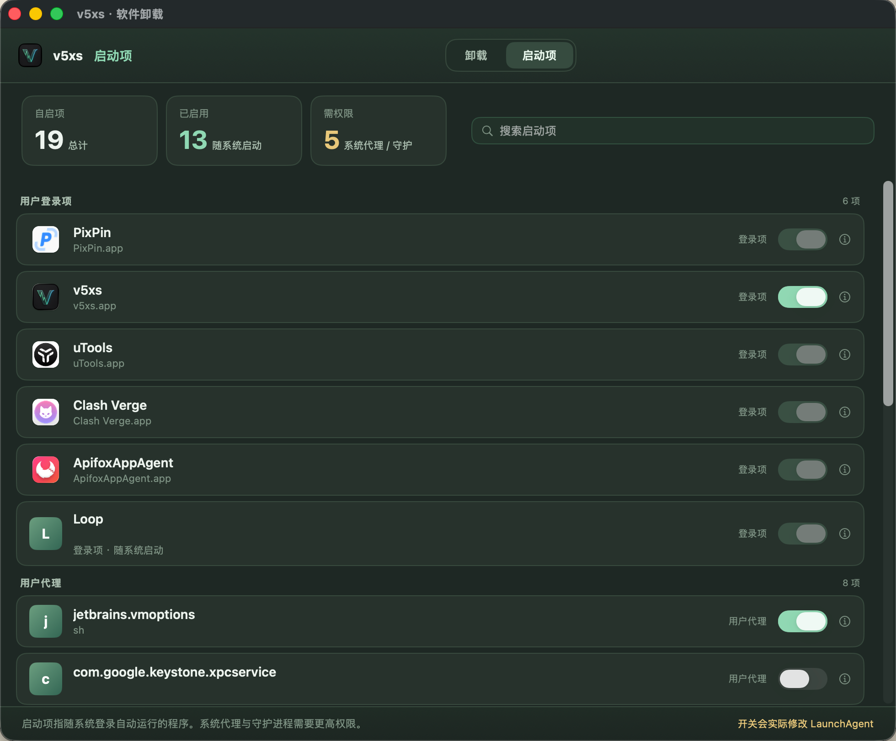
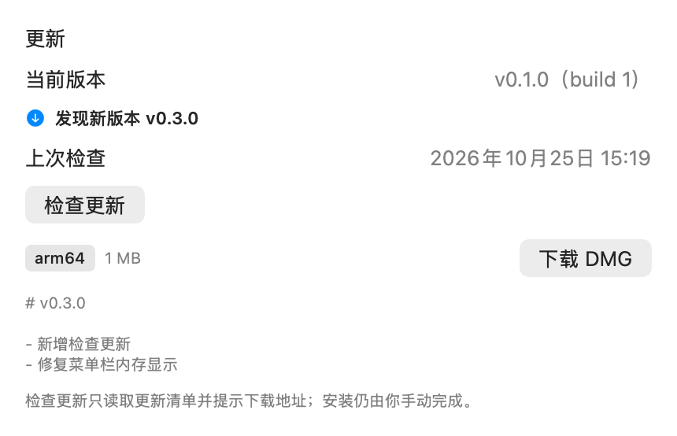

<p align="center"><strong>简体中文</strong> | <a href="README_EN.md">English</a></p>

# v5xs

在 macOS 菜单栏养一只「跑得越快越忙」的小动物，随时查看 CPU、GPU、内存、磁盘、网络与温度的实时状态；顺带清理不再需要的应用和开机自启项。

v5xs 是一款用 SwiftUI + AppKit 编写的 macOS 菜单栏系统监控工具。菜单栏只保留一只动物剪影：系统越忙它跑得越快，低负载时依然连贯。左键打开悬浮监控面板，右键即可更换形象或进入设置。

<p align="center">
  
</p>

## ✨ 特性

- **动态菜单栏动物**：CPU 越忙跑得越快；支持猫、兔、狐、狗、马、恐龙、青蛙、鸡、鸭、鱼等形象。
- **实时系统监控**：CPU 占用与核心拓扑、GPU 活跃度、内存、磁盘读写、网络上传/下载曲线、温度与热状态。
- **外设电量**：鼠标 / 键盘蓝牙电池，以及 Mac 本机电池，圆形指示器展示。
- **高占用进程**：按内存 / CPU 排序，支持终止、强制退出（需再次确认）。
- **软件卸载**：点按面板顶部评分卡片进入独立窗口，按名称 / 占用体积 / 最近使用 / 安装时间排序，批量选择应用并逐项核对关联文件后移入废纸篓。
- **启动项管理**：按来源分组列出登录项、LaunchAgent 与 LaunchDaemon，一键启用 / 禁用。
- **应用列表缓存**：扫描结果缓存到本地，缓存时长可在设置中调整（默认 30 天）。
- **检查更新**：读取更新清单比对 `CFBundleVersion`，有新版时在设置页展示版本与发行说明，并一键打开下载页。

## 📸 界面预览

| 🖥️ 监控面板 | 🗑️ 软件卸载 | ⚙️ 启动项 |
| --- | --- | --- |
|  |  |  |
| 实时系统状态总览 | 按需选择并核对关联文件后移入废纸篓 | 按来源分组管理开机自启项 |

> 更多界面的静态展示与可点击原型见 [docs/uninstall-design.md](docs/uninstall-design.md) 与 [docs/uninstall-prototype.html](docs/uninstall-prototype.html)（原型使用演示数据，不会移动文件）。

## 🚀 安装

### 直接运行（推荐）

从 [Releases](../../releases) 下载最新版 `v5xs.dmg`，将 v5xs 拖入“应用程序”文件夹即可。

### 从源码构建

需要 **macOS 14+**、**Swift 6** 与对应版本的 macOS SDK。推荐使用完整版 Xcode：

```bash
swift test
swift build
./scripts/build-app.sh
open dist/v5xs.app
```

若当前机器 Command Line Tools 的编译器与 SwiftPM 库版本不匹配，可直接使用脚本（无需安装完整 Xcode）：

```bash
bash scripts/test-local.sh   # 运行测试
bash scripts/build-app.sh    # 构建 .app
open dist/v5xs.app
```

构建界面安装包（带 Applications 拖拽入口的 DMG）：

```bash
bash scripts/build-dmg.sh
```

> DMG 脚本使用 `uv` 获取 `dmgbuild`。如需指定 SDK，设置 `MACOS_SDK=/path/to/MacOSX.sdk`。

## 🖱️ 使用

- **左键点击菜单栏动物**：打开 / 关闭监控面板。
- **右键点击菜单栏动物**：切换动物形象、暂停动画、设置登录启动、进入设置或退出。
- **点按面板顶部评分卡片**：打开软件卸载窗口。
- 卸载窗口顶部可切换 **卸载 / 启动项** 两个标签页。
- **右键菜单 → 检查更新…**：手动检查；发现新版本时菜单项会直接显示版本号。设置页「更新」分区显示当前版本、上次检查时间与检查结果。

## 🧭 数据与限制

- CPU 使用率、内存、磁盘、网络、本机电量与进程均来自实时系统数据。
- CPU 核数与性能 / 能效核拓扑来自 `ProcessInfo` / `sysctl`；GPU 核数与活跃度来自 System Profiler / `IOAccelerator`。
- CPU / GPU 温度通过已验证的 `Mac14,2` SMC 键读取；其他机型或读取失败时显示 “—” 并继续展示系统热状态。
- 顶部状态评分由热状态、CPU 使用率与内存占用**估算**，不代表硬件诊断结果。
- 软件卸载：最近使用来自 Spotlight（不可读时显示“未知”），大小为扫描估算；关联文件会扫描当前用户 `~/Library` 下与 Bundle ID 匹配的路径，共享文件与归属不明的路径不自动选中；确认后调用系统废纸篓。应用列表带缓存（默认 30 天，可在设置中调整）。
- 启动项：登录项、LaunchAgent / LaunchDaemon 按来源分组展示。用户级代理可直接开关；系统级代理与守护进程需管理员权限；第三方登录项建议在“系统设置 → 通用 → 登录项”中管理。
- 进程终止依赖应用权限，仅对当前仍可确认身份的 GUI 应用执行；**沙盒分发不能使用这些跨应用终止操作**。

## 🔄 自动更新

v5xs 可以自己下载新版、校验、替换并重启，也可以只提醒、由你决定何时安装。
**用户侧说明见 [docs/auto-update-guide.md](docs/auto-update-guide.md)。**

1. 启动后若距上次检查超过 24 小时，会在后台静默检查一次；也可在右键菜单或设置页手动触发。
2. 客户端用 `URLSession` 拉取 `Info.plist` 中 `V5XSUpdateFeedURL` 指向的 `update.json`——即每个正式版作为 **GitHub Releases 附件**发布的固定名清单（`releases/latest/download/update.json` 始终指向最新版；可用环境变量 `V5XS_UPDATE_FEED` 覆盖，便于本地联调）。
3. 清单包含版本号、构建号、最低系统版本、发行说明、各架构安装包的 URL / 大小 / SHA-256，以及 **Ed25519 签名**。
4. 比对 `CFBundleVersion`（相等时再比语义版本号）；有新版时先验签，通过才允许安装。
5. 点「下载并安装」后：下载 → SHA-256 校验 → 挂载 DMG → 校验 BundleID → 复制到同卷暂存区 → 退出 App → 独立脚本原子替换（失败自动回滚）→ 重新启动。

更新页有三个递进开关：自动检查（默认开）、自动下载（默认关）、自动重启安装（默认关）。

发布侧用 `scripts/make-update-manifest.sh`（默认按发布 tag 生成不可变的 DMG 下载地址，并自动签名）生成清单，可配合 [.github/workflows/publish-update-feed.yml](.github/workflows/publish-update-feed.yml) 把 `update.json` 自动上传为 Release 附件。发版前需在仓库配置签名 secret，见 [docs/update-signing.md](docs/update-signing.md)；发布流程见 [docs/update-publish.md](docs/update-publish.md)；各方案对比与选型理由见 [docs/update-research.md](docs/update-research.md)。

<p align="center">
  
</p>

> 当前边界：只做检查与跳转，不下载、不替换、不重启。清单与安装包走 HTTPS；建议后续为安装包补充签名校验（`downloads[].sha256` 字段已预留）。

## ✅ 测试环境

| 项目 | 版本 / 型号 |
| --- | --- |
| 操作系统 | macOS 26.4 (build 25E246) |
| 芯片 | Apple M2 (arm64) |
| 机型 | MacBook Air (Mac14,2) |
| 编译器 | Swift 6 / macOS SDK |

> 温度读取针对 `Mac14,2` SMC 键验证；其他机型或缺失数据时相关指标显示 “—”，其余功能不受影响（详见“数据与限制”）。
## 🧰 技术栈

- Swift 6 · SwiftUI · AppKit · Charts
- Swift Package Manager（`Package.swift`）
- 采样：CPU / GPU / 网络 1 秒一采样，温度与其余指标较慢；数据保留有界历史。

## 📄 License

[MIT](LICENSE) © 2026 [zhuyanwei](mailto:zyw090111@163.com)

## 🙏 致谢

- 界面设计参考 [docs/prototype.svg](docs/prototype.svg) 与 [docs/uninstall-design.md](docs/uninstall-design.md)。
- 卸载交互设计参考 [Mole](https://github.com/tw93/Mole) 的产品思路（实现独立，不依赖其代码）。

## ⭐ Star 趋势

如果你喜欢这个项目，欢迎点个 ⭐ 支持一下！增长趋势如下：

<!-- 请将下方 URL 中的 `OWNER/REPO` 替换为你实际的 GitHub 仓库路径，例如 `yourname/v5xs` -->
<p align="center">
  <a href="https://star-history.com/#zyw/v5xs&Date">
    
  </a>
</p>

