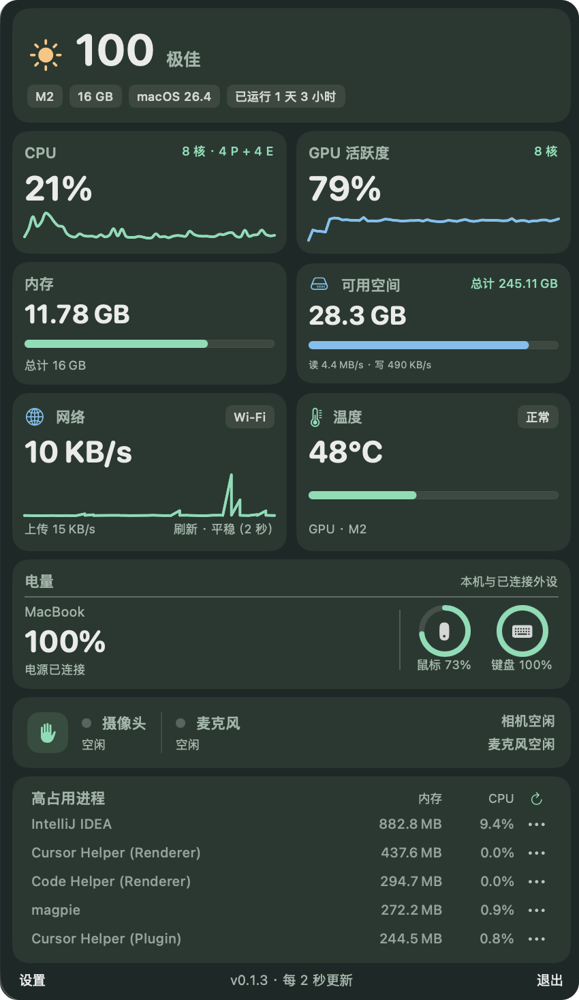
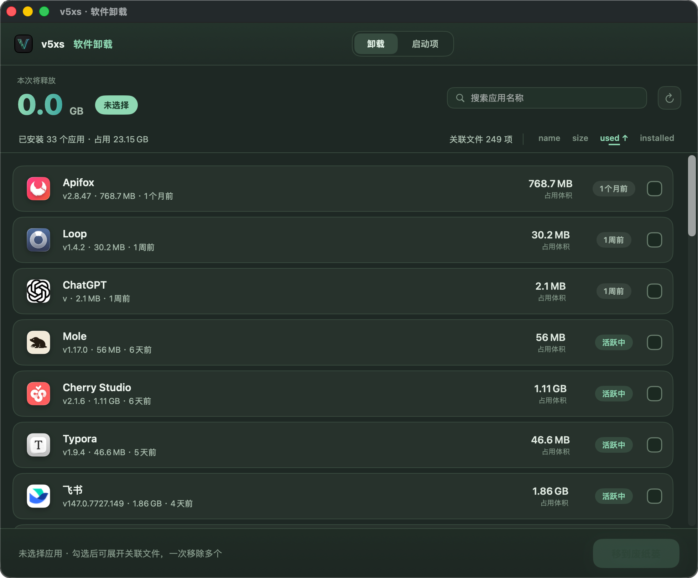
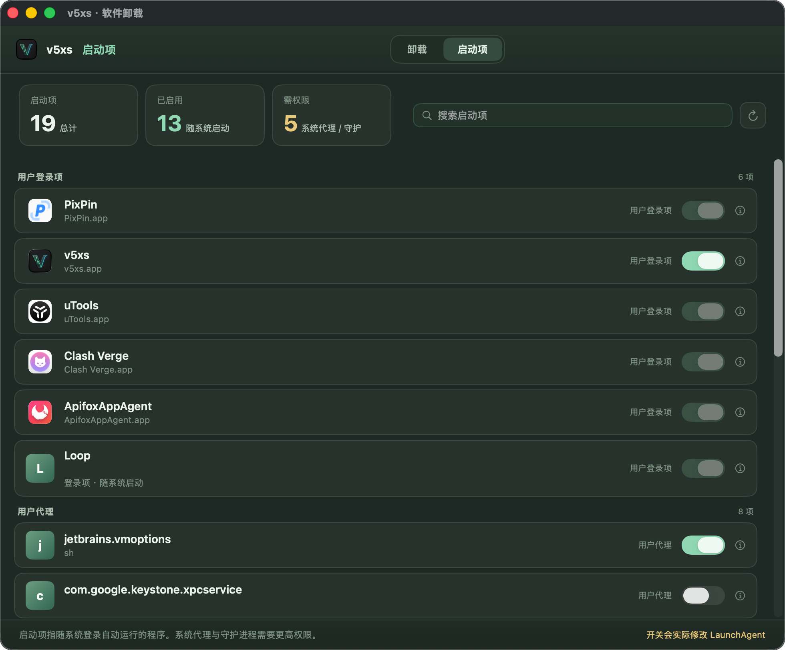
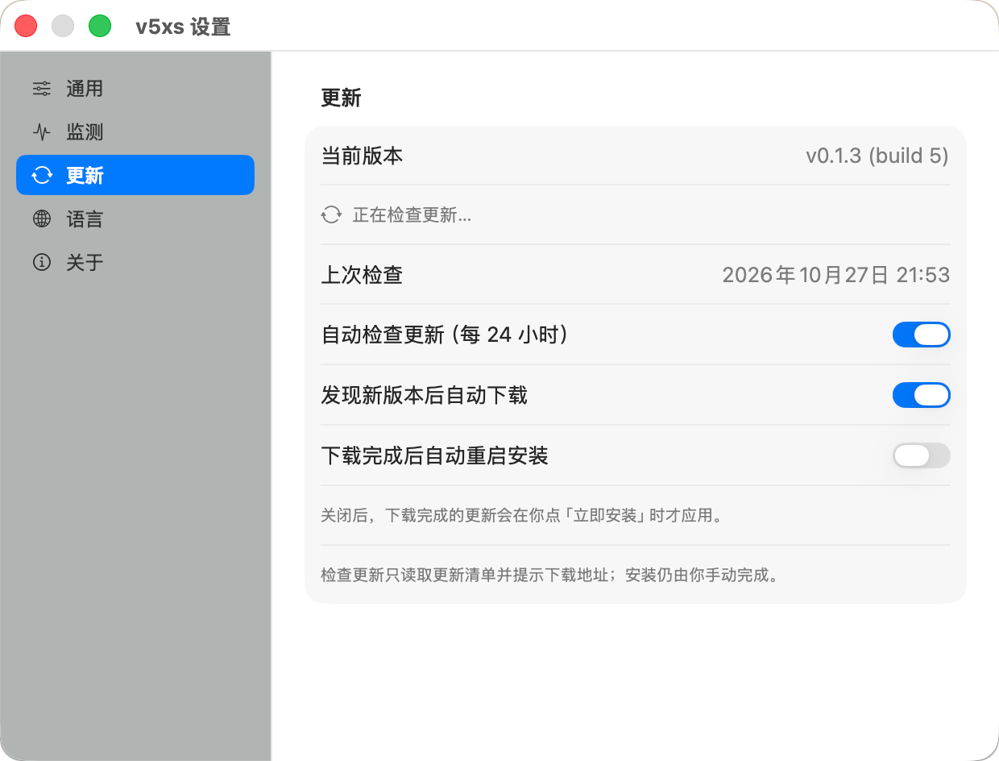

<p align="center"><a href="README.md">简体中文</a> | <strong>English</strong></p>

# v5xs

Keep a lively little animal in your macOS menu bar — it runs faster the busier your system gets — while you keep an eye on CPU, GPU, memory, disk, network and temperature, and clean up apps and startup items you no longer need.

v5xs is a macOS menu-bar system monitor written in **SwiftUI + AppKit**. It shows a single animal silhouette in the menu bar: the busier the system, the faster it runs, staying smooth even at low load. Left-click opens the floating monitor panel; right-click swaps the character or opens Settings.

<p align="center">
  
</p>

## ✨ Features

- **Animated menu bar animal**: runs at your CPU's pace; 14 characters (cat, rabbit, dog, horse, dinosaur, frog, chicken, duck, fish, plus sprinter, bolt, dragon, panda and tiger). A logo icon shows while animation is paused.
- **Real-time system monitoring**: CPU usage & core topology, GPU activity, memory, disk read/write, network up/down graph, temperature & thermal state.
- **Peripheral battery**: mouse / keyboard Bluetooth battery, plus Mac battery, shown as circular indicators.
- **High-usage processes**: sort by memory / CPU, terminate or force-quit (with confirmation).
- **App uninstaller**: tap the score card at the top of the panel to open a dedicated window; sort by name / size / last-used / install date, batch-select apps, review related files, then move them to Trash.
- **Startup items manager**: lists login items, LaunchAgents & LaunchDaemons grouped by source, with one-click enable / disable.
- **App list caching**: scan results are cached locally; the cache duration is adjustable in Settings (default 30 days).
- **Automatic updates**: downloads, verifies, replaces and relaunches by itself — or just notifies you and lets you decide when to install. Manifests are Ed25519-signed.
- **Configurable refresh rate**: 0.5 / 1 / 2 / 5 seconds, applied immediately.
- **Three languages**: Simplified Chinese, Traditional Chinese and English, switchable in Settings without a restart.

## 📸 Screenshots

| 🖥️ Monitor | 🗑️ Uninstaller | ⚙️ Startup Items |
| --- | --- | --- |
|  |  |  |
| Real-time system overview | Batch-select and review related files before moving to Trash | Grouped management of startup items |

> More static screens and a clickable prototype for the uninstaller are in [docs/uninstall-design.md](docs/uninstall-design.md) and [docs/uninstall-prototype.html](docs/uninstall-prototype.html) (the prototype uses demo data and never moves files).

## 🚀 Installation

### Run directly (recommended)

Download the latest DMG from [Releases](../../releases) (e.g. `v5xs-0.1.4-macOS-26.4-arm64.dmg`) and drag v5xs into the “Applications” folder.

> Gatekeeper may block the first launch (the build is ad-hoc signed); allow it under System Settings → Privacy & Security.
> Once 0.1.4 is installed, later versions can update themselves from within the app.

### Build from source

Requires **macOS 14+**, **Swift 6** and a matching macOS SDK. A full Xcode installation is recommended:

```bash
swift test
swift build
./scripts/build-app.sh
open dist/v5xs.app
```

If the Command Line Tools compiler and SwiftPM library versions don't match on your machine, use the scripts directly (no full Xcode needed):

```bash
bash scripts/test-local.sh   # run tests
bash scripts/build-app.sh    # build the .app
open dist/v5xs.app
```

To build the DMG (with a drag-to-Applications install window):

```bash
bash scripts/build-dmg.sh
```

> The DMG script uses `uv` to fetch `dmgbuild`. To use a specific SDK, set `MACOS_SDK=/path/to/MacOSX.sdk`.

## 🖱️ Usage

- **Left-click the menu bar animal**: open / close the monitor panel.
- **Right-click the menu bar animal**: switch character, pause animation, enable launch at login, open Settings, or quit.
- **Click the score card at the top of the panel**: open the software uninstaller window.
- The uninstaller window has two tabs at the top: **Uninstall / Startup Items**.
- **Right-click menu → Check for Updates…**: opens Settings on the “Updates” section and checks immediately; the item shows the version number once an update is found.
- **Right-click menu → Settings…**: opens Settings, always on the “General” page. A sidebar splits it into General / Monitoring / Updates / Language / About.

## 🧭 Data & Limitations

- CPU usage, memory, disk, network, Mac battery and processes come from live system data.
- CPU core counts and P/E-core topology are read from `ProcessInfo` / `sysctl`; GPU core count and activity come from System Profiler / `IOAccelerator`.
- CPU / GPU temperatures are read from SMC keys verified on a `Mac14,2` (MacBook Air M2). On other models or when unavailable they show “—” while thermal state continues to work.
- The top score is an **estimate** based on thermal state, CPU and memory usage — not a hardware diagnostic.
- Uninstaller: last-used comes from Spotlight (shows “unknown” when unavailable); sizes are scanned estimates. Related files are matched against the current user's `~/Library` by bundle ID; shared files and files of unclear ownership are not auto-selected. Confirmed files are moved to the system Trash. The app list is cached locally (default 30 days, adjustable in Settings).
- Startup items: login items, LaunchAgents & LaunchDaemons are shown grouped by source. User-level agents can be toggled directly; system agents & daemons require admin privileges; third-party login items are best managed in “System Settings → General → Login Items”.
- Process identity is resolved through `libproc` / `sysctl` (full path plus start time), so non-GUI processes — java, helpers, daemons — work too; identity is re-checked before signalling to avoid killing a recycled PID. Insufficient permissions produce a specific explanation. **Sandbox distribution cannot use these cross-app termination operations**.

## 🔄 Automatic Updates

v5xs can download, verify, replace and relaunch itself — or simply notify you and let you decide when to install.
**User-facing guide: [docs/auto-update-guide.md](docs/auto-update-guide.md).**

1. On launch it checks in the background if the last check is older than 24 hours; you can also trigger it from the right-click menu or Settings.
2. The client fetches the `update.json` manifest from `V5XSUpdateFeedURL` in `Info.plist` via `URLSession` — a fixed-name file published as a **GitHub Release asset** (`releases/latest/download/update.json` always points at the newest; override with `V5XS_UPDATE_FEED` for local testing).
3. The manifest carries the version, build number, minimum system version, release notes, per-architecture download URL / size / SHA-256, and an **Ed25519 signature**.
4. The client compares `CFBundleVersion` (falling back to semantic version when equal); a newer build is accepted only after the signature verifies.
5. "Download Update" runs: download → SHA-256 check → mount DMG → verify bundle ID → copy into a staging dir on the same volume. If automatic restart is off, click "Update and Restart" beside the version; otherwise the app quits immediately, the script swaps the bundle atomically (rolling back on failure), and the app relaunches.

Three progressive toggles in the Updates page: auto-check (on), auto-download (off), auto-install (off).

Publishing uses `scripts/make-update-manifest.sh`, which signs the manifest by default and pairs with [.github/workflows/publish-update-feed.yml](.github/workflows/publish-update-feed.yml) to upload `update.json` as a release asset. A signing secret must be configured in the repository first — see [docs/update-signing.md](docs/update-signing.md); release flow in [docs/update-publish.md](docs/update-publish.md); design comparison in [docs/update-research.md](docs/update-research.md).

<p align="center">
  
</p>

**Security model**: the build is ad-hoc signed, so code-signature verification can't establish identity. The trust root for updates is the **Ed25519 public key compiled into the app** — a manifest is only accepted if it carries a signature made with the matching private key. This matters because the SHA-256 inside a manifest comes from the same HTTPS response as the manifest itself: if the feed is hijacked, both can be swapped together and checksums prove nothing.

Hard checks before installing (any failure aborts): manifest signature → package size & SHA-256 → bundle ID inside the package → free disk space → whether the app runs from a read-only location → whether multiple instances are running.

**Known limits**: no downgrade path; when `/Applications` is not writable the app tells you to install manually rather than failing silently.

## ✅ Tested Environment

| Item | Version / Model |
| --- | --- |
| OS | macOS 26.4 (build 25E246) |
| Chip | Apple M2 (arm64) |
| Machine | MacBook Air (Mac14,2) |
| Toolchain | Swift 6 / macOS SDK |

> Temperature reading is validated against the `Mac14,2` SMC keys; on other machines the related metrics show “—” while everything else is unaffected (see “Data & Limitations”).

## 🧰 Tech Stack

- Swift 6 · SwiftUI · AppKit · Charts
- Swift Package Manager (`Package.swift`)
- Sampling: CPU / GPU / network use the configurable refresh rate (default 1s; 0.5 / 1 / 2 / 5s); temperature and other metrics less frequently; bounded in-memory history.
- Localization: runtime string table injected through the SwiftUI environment; switching language needs no restart.
- Update verification: CryptoKit (Ed25519 + SHA-256).

## 📄 License

[MIT](LICENSE) © 2026 [zhuyanwei](mailto:zyw090111@163.com)

## 🙏 Credits

- UI design references: [docs/prototype.svg](docs/prototype.svg) and [docs/uninstall-design.md](docs/uninstall-design.md).
- Uninstaller interaction concept inspired by [Mole](https://github.com/tw93/Mole) (independent implementation, no dependency).

## ⭐ Star History

If you like this project, give it a ⭐! Here's the growth trend:

<p align="center">
  <a href="https://star-history.com/#zyw/v5xs&Date">
    
  </a>
</p>
